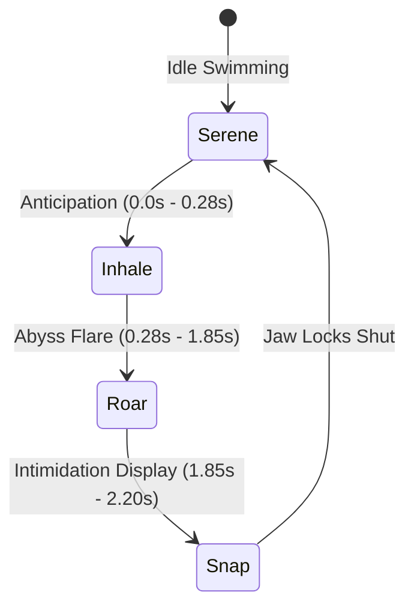

# 2.5D Spline Kinematics & Modular Creature Motion Architecture

> **A Comprehensive Guide to Engineering Infinite Organic Locomotion on the Web**  
> *Inspired by Studio VØR, Pizza Samurai Frogs, and Awwwards Site-of-the-Day Creative Engineering.*

---

## 🧭 Overview & Philosophy

Building organic, living creatures on the web often forces a painful compromise:
- **Full 3D (WebGL / Three.js / Spline):** High asset payload (20MB–50MB), heavy shader compilation stutters on mobile devices, complex bone rigging, and uncanny valley lighting.
- **Pre-rendered Video / Spritesheets:** Massive file sizes, non-interactive camera perspectives, rigid frame rates, and zero real-time responsiveness.

This document breaks down the **2.5D Spline Conveyor Technique** developed for **JÖRMUN**. By shingling modular, pre-rendered 2.5D anatomical units along parametric Bezier curves with harmonic kinematics, we achieve **ultra-smooth organic locomotion, real-time roaring state machines, and dynamic depth at 160+ FPS on a ~6MB total footprint**.

---

## 📐 1. Cubic Bezier Curve Parameterization

A continuous serpentine body is driven by a series of cubic Bezier curves in screen space.

### The Mathematics

A cubic Bezier curve is defined by four control points:
- $P_0$: Starting point (entry)
- $P_1$: First control handle
- $P_2$: Second control handle
- $P_3$: Ending point (exit or head socket)

For any normalized progress parameter $u \in [0.0, 1.0]$:

$$B(u) = (1 - u)^3 P_0 + 3(1 - u)^2 u P_1 + 3(1 - u) u^2 P_2 + u^3 P_3$$

### Computing Tangent Angle & Rotation

To orient each scale segment naturally along the spine, we compute the first derivative with respect to $u$:

$$B'(u) = 3(1 - u)^2 (P_1 - P_0) + 6(1 - u)u (P_2 - P_1) + 3u^2 (P_3 - P_2)$$

The rotation angle $\theta(u)$ of the segment at progress $u$ is then:

$$\theta(u) = \operatorname{atan2}(B'_y(u), B'_x(u))$$

```javascript
function getBezierPoint(p0, p1, p2, p3, u) {
  const t = Math.max(0, Math.min(1, u));
  const mt = 1 - t;
  const mt2 = mt * mt;
  const t2 = t * t;

  return {
    x: mt2 * mt * p0.x + 3 * mt2 * t * p1.x + 3 * mt * t2 * p2.x + t2 * t * p3.x,
    y: mt2 * mt * p0.y + 3 * mt2 * t * p1.y + 3 * mt * t2 * p2.y + t2 * t * p3.y
  };
}

function getBezierTangent(p0, p1, p2, p3, u) {
  const t = Math.max(0, Math.min(1, u));
  const mt = 1 - t;

  const dx = 3 * mt * mt * (p1.x - p0.x) + 6 * mt * t * (p2.x - p1.x) + 3 * t * t * (p3.x - p2.x);
  const dy = 3 * mt * mt * (p1.y - p0.y) + 6 * mt * t * (p2.y - p1.y) + 3 * t * t * (p3.y - p2.y);

  return Math.atan2(dy, dx);
}
```

---

## 🔄 2. The Continuous Zero-Pop Conveyor Loop

To make a creature look infinitely long and constantly undulating without visible seam breaks:

### 1. Normalized Shingling
Distribute $N$ discrete segments evenly along the normalized spline:

$$u_i(t) = \left( \frac{i}{N} + \phi(t) \right) \pmod{1.0}$$

Where $\phi(t)$ is the accumulated phase over time $t$.

### 2. Forward Locomotion & Scale Sweep Direction
- **Rule of Hydrodynamics:** When a sea serpent or fish swims forward to the **LEFT**, water flows to the **RIGHT**.
- Therefore, the dorsal fins and overlapping diamond scales must point **BACKWARD (to the right)**.
- The phase accumulation $\phi(t)$ must move segments toward the head at $u = 1.0$ (negative phase velocity).

### 3. Edge Feathering (Alpha Falloff)
To prevent segments from abruptly popping into existence at $u = 0.0$ or popping out at $u = 1.0$, apply a cosine or smoothstep fade envelope:

```javascript
let alpha = 1.0;
// Smooth entry fade
if (u < 0.12) {
  alpha = Math.sin((u / 0.12) * (Math.PI / 2));
}
// Smooth exit fade into neck collar
else if (u > 0.88) {
  alpha = Math.cos(((u - 0.88) / 0.12) * (Math.PI / 2));
}
```

---

## 🫁 3. Harmonic Respiration & Cadence Kinematics

Mechanical conveyors look robotic because their speed is constant ($v = \text{const}$). Living biological organisms swim in a **thrust-and-glide** cadence synchronized with breathing.

We modulate the velocity and spine height with harmonic sinusoidal oscillators:

```javascript
const breathOmega = 0.85; // Respiration speed (rad/s)
const respirationPhase = time * breathOmega;

// Vertical heave of the entire spine
const spineBreath = Math.sin(respirationPhase) * (viewportHeight * 0.016);

// Harmonic speed modulation (burst thrust followed by relaxed glide)
const speedModulation = (baseSpeed * 0.22 / breathOmega) * Math.sin(respirationPhase);
const phase = (-(baseSpeed * time + speedModulation)) % 1.0;
```

---

## 🐲 4. Anatomical Coupling: The Neck Collar Socket

The **"Treadmill Paradox"** happens when an infinite stream of moving body scales collides with a rigid, stationary head. The eye immediately sees a severed head glued onto a woodchipper.

### How to Fix It:
1. **The Overlapping Dermal Skirt:**  
   The dragon head asset must end with a flared skirt of ivory scales angled at the exact approach angle ($\approx 45^\circ$) of the incoming spline.
2. **Sub-Collar Inset (Tucking):**  
   Body segments do not stop at the neck border; they continue into $u \in [0.90, 1.00]$, rendering *underneath* the head's alpha channel.
3. **Harmonic Head Reaction:**  
   When the body surges, the head must bob in harmonic phase ($y_{\text{bob}} = \cos(\text{phase}) \cdot A$) with micro-rotations ($\pm 1.5^\circ$), maintaining biological cohesion.

---

## ⚡ 5. Performance Engineering: From 1 FPS to 160+ FPS

During initial testing, dynamic canvas shadows and CSS filters dropped the framerate to **1 FPS**. Here is how we restored a locked **160+ FPS**:

### The Pitfall: Live `ctx.filter` and `ctx.shadowBlur`
```javascript
// ❌ FATAL BOTTLENECK: Forces CPU re-rasterization on every tile every frame
ctx.filter = 'contrast(1.2) brightness(0.95)';
ctx.shadowColor = '#04080F';
ctx.shadowBlur = 15;
ctx.drawImage(segmentImg, ...); // Called 100+ times per frame!
```

### The Solution: Pre-Baked 2.5D Lighting & GPU Composition
1. **Bake Contrast & Shading into the Asset:**  
   Use an image processing pipeline or neural upscaler to bake ambient occlusion crevices, warm ivory specular highlights, and crisp edge alpha directly into the master PNG sprite (`dragon_body_canonical_2.5d_unit.png`).
2. **Hardware Canvas Promotion:**  
   Apply 3D transform layers in CSS so the browser promotes canvases to separate GPU memory planes:
   ```css
   #front-serpent-canvas, #back-serpent-canvas {
     transform: translateZ(0);
     will-change: transform;
   }
   ```
3. **Pure Matrix Transformation:**  
   Use native affine transforms without filter pipelines:
   ```javascript
   ctx.save();
   ctx.translate(posX, posY);
   ctx.rotate(angle);
   ctx.scale(scaleX, scaleY);
   ctx.globalAlpha = alpha;
   ctx.drawImage(cachedUnitImg, -w / 2, -h / 2, w, h);
   ctx.restore();
   ```

---

## 🔊 6. Real-Time Biological Roar State Machine

To elevate the creature from an ambient loop into an intimidating apex predator, we orchestrate a state machine coordinating graphics, light, and audio:



### Mutually Exclusive Jaw Swapping
To guarantee **zero ghosting** or double-snout artifacts:
```javascript
if (isMouthOpen) {
  // Render open-mouth asset with cyan throat glow
  ctx.drawImage(headOpenImg, -hw / 2, -hh / 2, hw, hh);
} else {
  // Render closed-mouth asset with razor-sharp ivory teeth
  ctx.drawImage(headClosedImg, -hw / 2, -hh / 2, hw, hh);
}
```

---

## 💻 7. Minimal Copy-and-Paste Starter Template

You can adapt this pattern for snakes, dragons, mechanical tentacles, or sci-fi energy cables:

```html
<!DOCTYPE html>
<html>
<head>
  <style>
    body { margin: 0; background: #04080F; overflow: hidden; }
    canvas { display: block; width: 100vw; height: 100vh; transform: translateZ(0); }
  </style>
</head>
<body>
  <canvas id="motionCanvas"></canvas>

  <script>
    const canvas = document.getElementById('motionCanvas');
    const ctx = canvas.getContext('2d');
    let w, h;

    function resize() {
      w = canvas.width = window.innerWidth;
      h = canvas.height = window.innerHeight;
    }
    window.addEventListener('resize', resize);
    resize();

    // Load your repeatable modular slice unit
    const unitImg = new Image();
    unitImg.src = 'assets/dragon_body_canonical_2.5d_unit.png';

    const SEGMENT_COUNT = 32;
    const SPEED = 0.08;

    function draw(time) {
      ctx.clearRect(0, 0, w, h);

      // Define Bezier Spine Points
      const p0 = { x: w * 1.1, y: h * 0.85 };
      const p1 = { x: w * 0.6, y: h * 0.65 };
      const p2 = { x: w * 0.3, y: h * 0.95 };
      const p3 = { x: -w * 0.1, y: h * 0.75 };

      const basePhase = (time * SPEED) % 1.0;

      for (let i = 0; i < SEGMENT_COUNT; i++) {
        const u = ((i / SEGMENT_COUNT) + basePhase) % 1.0;

        // Bezier Position & Tangent
        const mt = 1 - u;
        const x = mt*mt*mt*p0.x + 3*mt*mt*u*p1.x + 3*mt*u*u*p2.x + u*u*u*p3.x;
        const y = mt*mt*mt*p0.y + 3*mt*mt*u*p1.y + 3*mt*u*u*p2.y + u*u*u*p3.y;

        const dx = 3*mt*mt*(p1.x-p0.x) + 6*mt*u*(p2.x-p1.x) + 3*u*u*(p3.x-p2.x);
        const dy = 3*mt*mt*(p1.y-p0.y) + 6*mt*u*(p2.y-p1.y) + 3*u*u*(p3.y-p2.y);
        const angle = Math.atan2(dy, dx);

        // Alpha edge fade
        let alpha = 1.0;
        if (u < 0.1) alpha = u / 0.1;
        if (u > 0.9) alpha = (1.0 - u) / 0.1;

        ctx.save();
        ctx.translate(x, y);
        ctx.rotate(angle);
        ctx.globalAlpha = alpha;
        ctx.drawImage(unitImg, -60, -45, 120, 90);
        ctx.restore();
      }

      requestAnimationFrame((t) => draw(t * 0.001));
    }

    unitImg.onload = () => requestAnimationFrame((t) => draw(t * 0.001));
  </script>
</body>
</html>
```

---

## 📜 Credits & Citation

Engineered for **ARCHIVE 04 // JÖRMUN**. If you use these motion equations or spline shingling techniques in your interactive art or commercial work, credit is appreciated:

```text
Motion Kinematics & 2.5D Conveyor Architecture
Based on ARCHIVE 04 // JÖRMUN (2026)
Inspired by Studio VØR & Pizza Samurai Frogs
```

